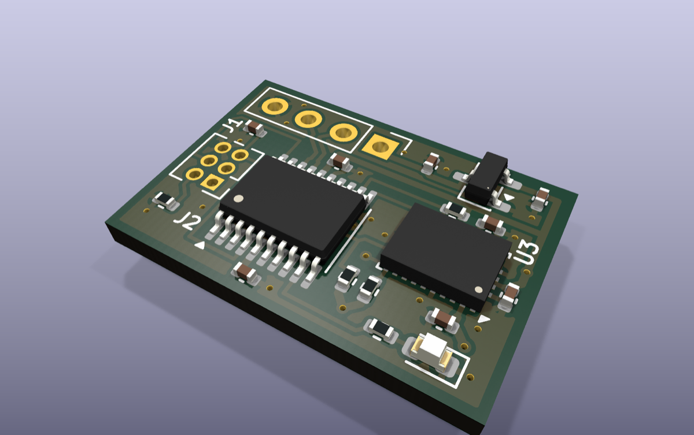
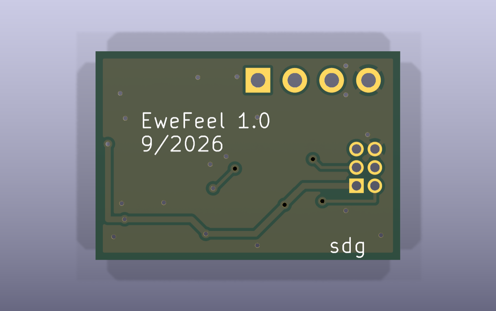
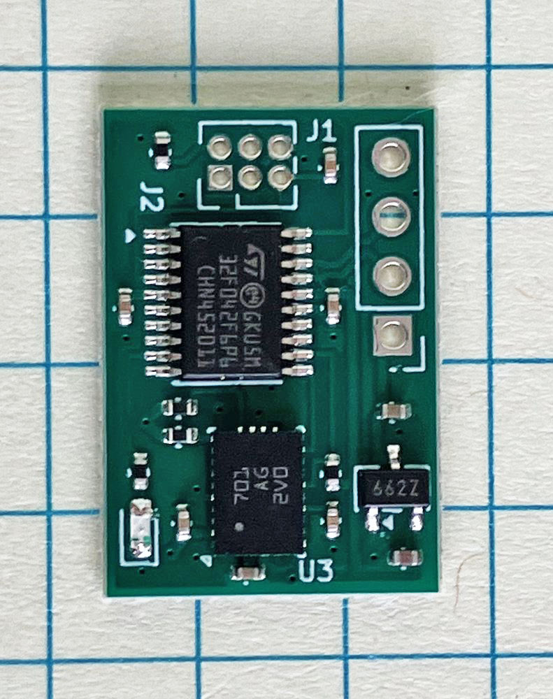
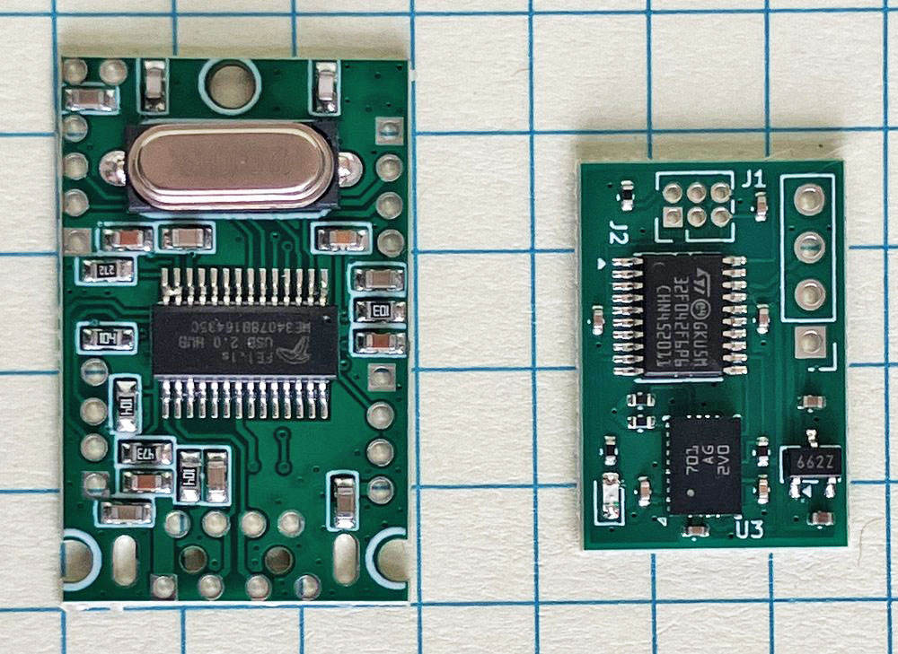
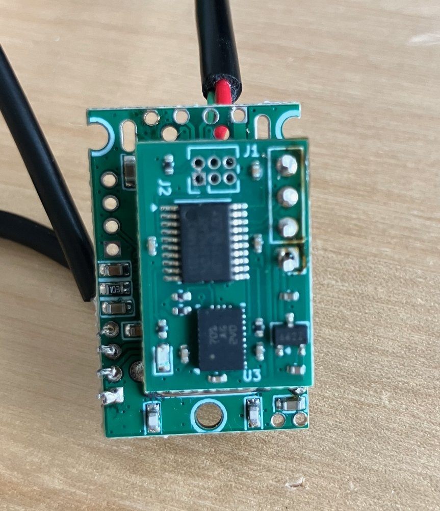

# hub_imu: USB IMU module for FE1.1S USB 2.0 hubs

A small 2-layer module that stacks onto a USB 2.0 hub board built around the
Terminus **FE1.1S** hub IC, such as
[these hubs on Amazon](https://www.amazon.com/dp/B0GTVPVPV9). It plugs into one of the
hub's downstream ports through a 0.1" 1x4 header and appears on the host as a
USB device that bridges to a Bosch BNO055 9-axis IMU over I2C.

- **Board:** 21.0 x 14.4 mm, 2 layers, 1.6 mm FR4, 1 oz copper (JLCPCB standard rules)
- **Tools:** KiCad 9.0

| Top | Bottom |
|---|---|
|  |  |

The renders come from KiCad's 3D viewer. The J1 and J2 headers are marked do-not-populate (hand-soldered), so they don't appear.

### Photos

| Assembled module | Next to an FE1.1S hub | Stacked onto the hub |
|---|---|---|
|  |  |  |

## Contents

| File | What it is |
|---|---|
| `hub_imu.kicad_pro` / `.kicad_sch` / `.kicad_pcb` | KiCad project, schematic, layout |
| `hub_imu.kicad_dru` | Custom design rules (see below) |
| `stage1.svg` ... `stage5.svg` | Layout renders (F.Cu, B.Cu, F.SilkS, Edge.Cuts) after placement, power, USB, signals, pours |
| `drc_stage1.rpt` ... `drc_stage5.rpt` | DRC report after each stage (`drc_stage5.rpt` is the final one) |
| `production/hub_imu.zip` | Gerbers and drill files for JLCPCB (from the Fabrication Toolkit plugin) |
| `images/` | 3D renders and photos used in this README |
| `firmware/` | STM32F042 firmware, built by CI ([README](firmware/README.md)) |
| `NOTES.md` | history, status and gotchas for whoever picks this up next |

## Circuit

| Ref | Part | JLCPCB # (basic) | Role |
|---|---|---|---|
| U1 | STM32F042F6P6 (TSSOP-20) | - (not basic) | Crystal-less USB FS device, USB-to-I2C bridge |
| U2 | BNO055 (LGA-28) | - (not basic) | 9-axis IMU, I2C mode (PS0 = PS1 = GND), address 0x28 (COM3 = GND) |
| U3 | XC6206P332MR (SOT-23-3) | C5446 | 5 V to 3.3 V LDO, 200 mA (pins: 1 VSS, 2 VOUT, 3 VIN), the only heat source |
| J1 | 1x4 2.54 mm header | - (hand-solder) | Connection to the hub |
| J2 | 2x3 1.27 mm header | - (hand-solder) | SWD programming/debug |
| D1 | Red LED, 0603 (KT-0603R) | C2286 | Status LED on PA3 |
| R5 | 1k 0402 | C11702 | LED resistor (~1.3 mA) |
| R3, R4 | 4.7k 0402 | C25900 | I2C pull-ups |
| R1, R2 | 10k 0402 | C25744 | BOOT0 pull-down, BNO055 nRESET pull-up |
| C1 | 1 uF 0402, 25 V X5R | C52923 | LDO input (+5V) |
| C2 | 4.7 uF 0402, 10 V X5R | C23733 | LDO output (+3V3) |
| C3-C8 | 100 nF 0402, 16 V X7R | C1525 | NRST filter; decoupling (U1 VDD, U1 VDDA, U2 VDD, U2 VDDIO, U2 CAP) |

Every assembled part has a `JLCPCB Part #` field in the schematic and PCB, taken from
[JLCPCB's basic parts library](https://jlcpcb.com/parts/basic_parts). U1, U2, J1 and J2
have the field left blank: the ICs aren't basic parts, and the headers are fitted by hand.

### J1 - hub connector (0.1" pitch)

| Pin | Signal |
|---|---|
| 1 | +5V (VBUS) |
| 2 | USB D- |
| 3 | USB D+ |
| 4 | GND |

This pin order has been checked against the hub's downstream-port header.

### J2 - SWD (2x3, 1.27 mm)

| Pin | Signal | Pin | Signal |
|---|---|---|---|
| 1 | +3V3 | 2 | BOOT0 |
| 3 | SWDIO | 4 | SWCLK |
| 5 | NRST | 6 | GND |

This is a custom pinout, not a standard ARM SWD connector, so an adapter or cable is needed.

## Firmware notes (STM32F042F6P6)

| Function | Pin |
|---|---|
| USB D- / D+ | PA11 / PA12 on pins 17/18. **Set `SYSCFG_CFGR1.PA11_PA12_RMP`**, or USB will not enumerate (these pins default to PA9/PA10). |
| I2C1 SDA / SCL | PF0 / PF1 (AF1) |
| BNO055 INT | PA5 (pin 11), EXTI |
| BNO055 nRESET | PA6 (pin 12), drive low to reset (10k pull-up on board) |
| Status LED | PA3 (pin 9), active high, ~1.3 mA (red 0603 LED + 1k) |
| SWD | PA13 / PA14 |

Use the internal HSI48 clock with CRS synced to USB SOF. There is no crystal, and the BNO055's 32 kHz crystal pins are left open (internal clock).

## Layout notes

- All components are on the top side.
- The bottom layer is a GND plane that also carries +3V3 distribution. Signals are on top, apart from four short jumpers: SDA under SCL, and BOOT0 / SWDIO to J2's through-hole pins.
- The USB D+/D- pair is 0.25 mm wide with a 0.2 mm gap, has no vias, and is length-matched (0 mm skew). Solid ground runs underneath it (bottom-layer track/via keepout `USB_BCu_keepout`).
- There are no bottom-layer tracks or vias under the IMU (`U2_BCu_keepout`), and no top copper inside U2's pad ring (`U2_FCu_interior`).
- Every decoupling cap is within 2 mm of the pin it serves and has an adjacent GND via.

### Custom design rules (`hub_imu.kicad_dru`)

- 0.2 mm minimum track and clearance; vias 0.6 mm pad / 0.3 mm drill.
- +5V / +3V3 tracks are 0.4 mm, necking to 0.25 mm only inside U2's courtyard (its pads are 0.254 mm wide).
- USB tracks are exactly 0.25 mm.
- No bottom-layer tracks or vias intersecting U2's courtyard.
- R1 and U1 GND pads may have one thermal spoke; both also have a direct track to a GND via.

## Verification status

The final DRC (`drc_stage5.rpt`) shows **0 errors and 0 unconnected pads**. The remaining items are
`lib_footprint_mismatch` warnings on the 0402, SOT-23-3 and LGA footprints. They come from KiCad re-save
rounding on rotated footprints, not from real geometry changes.

ERC reports only `lib_symbol_issues`, because the `hubimu` symbols are embedded in the schematic
rather than installed as a library.

## BNO055 datasheet check

Checked against Bosch BST-BNO055-DS000-18 (rev 1.8, Oct 2021); page numbers are the datasheet's own:

- **Reserved pins:** Table 5-1 (p. 106) marks PIN1, 12, 13, 15, 16, 21-24 and BL_IND (10) as "Do not connect". All are unconnected here.
- **Protocol/address pins:** PS1, PS0, COM2 and COM3 are tied to GND for I2C at 0x28 (Tables 4-4/4-5, p. 99; PS pins must not float).
- **XIN32/XOUT32:** left open for the internal clock (sec. 5.5.2, p. 111; internal clock tolerance up to ±3%).
- **CAP (9):** Fig. 9 (p. 107) shows 120 nF. C8 is 100 nF because there is no 120 nF JLCPCB basic part, and the figure's values are "typical example" only (footnote 9, p. 110).
- **nBOOT_LOAD_PIN (4):** Fig. 9 shows an optional 10k pull-up. Here it is tied directly to +3V3, so the part always boots the application (sec. 3.10, p. 51). The BNO055's own firmware cannot be updated on this board.

## Design decisions

- MCU decoupling is 100 nF each on VDD and VDDA, plus 4.7 uF at the LDO output on the same short +3V3 net. ST's usual guidance also suggests 1 uF + 10 nF on VDDA. This was judged unnecessary here: the supply traces are short, and the ADC is not used for anything precision-critical.

There are no open items.

## License

The hardware design is licensed under the [CERN Open Hardware Licence v2, Permissive](LICENSE) (CERN-OHL-P-2.0).
